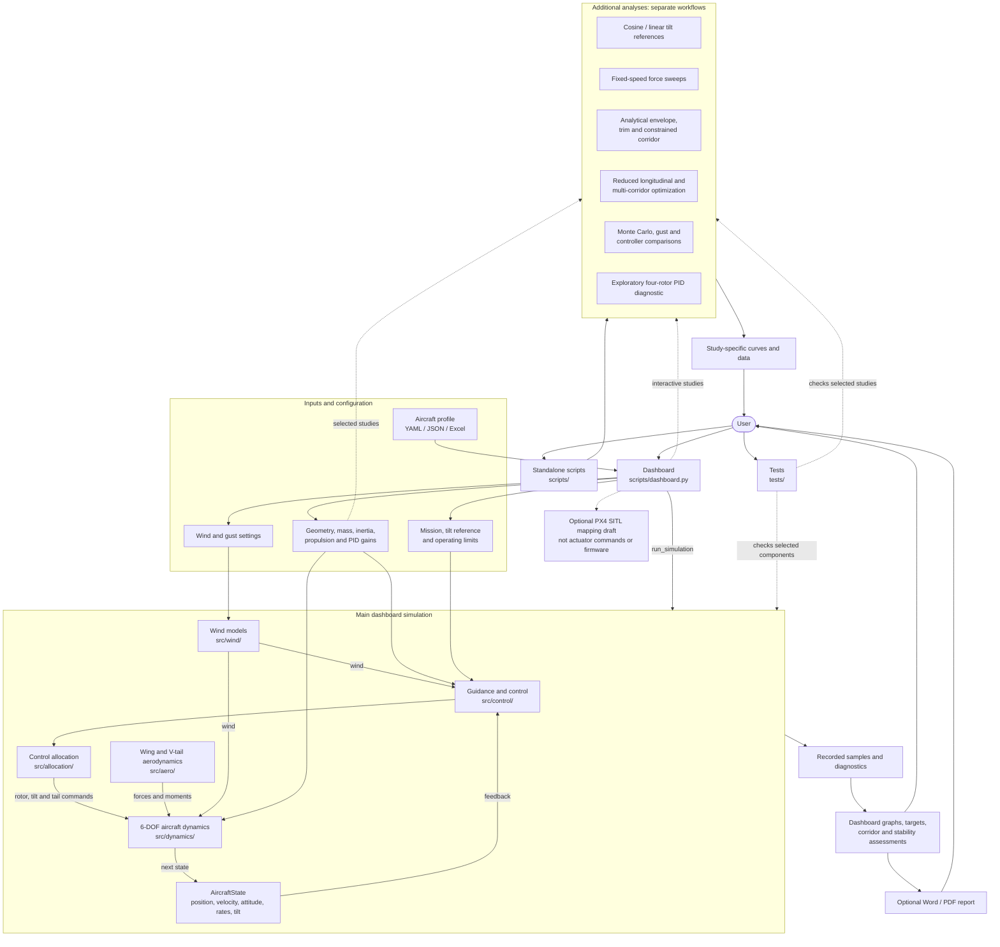
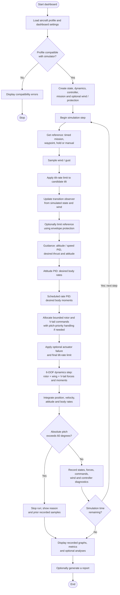
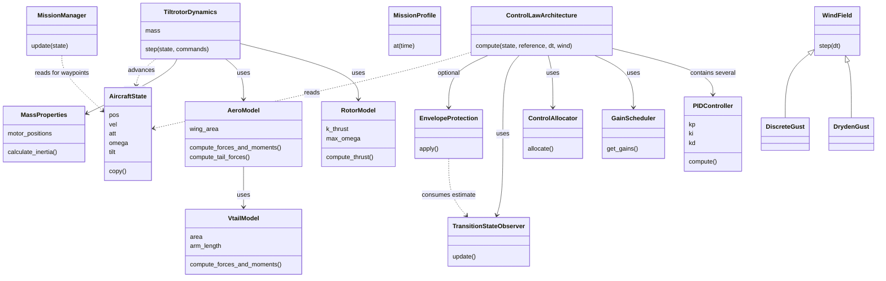

# Tiltrotor transition project: structure and flowcharts

These diagrams describe the code as implemented. They show simulation and
analysis workflows, not a flight-ready control system.

## 1. Overall project structure

Solid arrows show a data or control flow; dotted arrows indicate optional use
or testing. The additional studies are not all part of one simulation run.

## 2. Dashboard closed-loop simulation

In the current dashboard, the **60-degree pitch check happens before the new
sample is logged**. The chart therefore ends at the last recorded sample. The
dashboard controller receives the simulated state and wind directly; the
filtered transition observer is used for monitoring and optional protection,
not as a full sensor-estimation system. The diagram does not imply a general
ground-impact termination check in this dashboard loop.

## 3. Main object-oriented relationships

This is a **selected class relationship diagram**, not an exhaustive UML class
inventory. The project is **mixed-paradigm**: it uses classes and objects for
state, models and controllers, while many analysis routines and scripts are
procedural. For example, `WindField` has subclasses, whereas the controller
primarily combines other objects rather than inheriting from them.

## 4. Separate study paths and outputs

| Study | Entry point | What it produces / important distinction |
|---|---|---|
| Dashboard simulation | [dashboard.py](scripts/dashboard.py) | Interactive 6-DOF state, force, control, mission and gust plots. |
| Additional dashboard studies | [dashboard_transition_analyses.py](scripts/dashboard_transition_analyses.py) | Interactive references, sweeps, analytical envelope, reduced optimizer and PID diagnostic. They do not all use the active dashboard model. |
| Force sweeps | [plot_force_model_curves.py](scripts/plot_force_model_curves.py) | Fixed-hover-speed, level-attitude force and acceleration sweeps; no rotor wash in the sweep; not a closed-loop trajectory. |
| Analytical tilt-speed envelope | [plot_tilt_angle_vs_velocity.py](scripts/plot_tilt_angle_vs_velocity.py) and [transition.py](src/dynamics/transition.py) | Approximate separate force-bound screening, not verified simultaneous trim or a safe corridor. |
| Reduced longitudinal optimization | [optimize_longitudinal_transition.py](scripts/optimize_longitudinal_transition.py) | Separate 2D point-mass trajectory and force curves; not full 6-DOF or gust validation. |
| Multiple corridors | [multi_corridor.py](scripts/multi_corridor.py) | Separate simplified vertical-model objectives: fast, safe and smooth labels; not certified corridors. |
| Master simulation | [master_simulation.py](scripts/master_simulation.py) | Separate PID cascade and CSV reference workflow with its own gust handling and single equivalent rotor command; not the dashboard control architecture. |
| Exploratory PID diagnostic | [plot_master_pid_diagnostics.py](scripts/plot_master_pid_diagnostics.py) | Separate four-rotor diagnostic using an illustrative profile and unverified motor-speed assumption; stops at its pitch or ground limit. |
| Dashboard Monte Carlo | [monte_carlo.py](src/simulation/monte_carlo.py) | Seeded scenarios and optional actuator failures run through a supplied simulation callback. |
| Standalone comparisons | [monte_carlo_gusts.py](scripts/monte_carlo_gusts.py), [compare_indi_dob.py](scripts/compare_indi_dob.py) | Separate controller-comparison scripts; their configurations and results are not interchangeable with dashboard Monte Carlo. |

The master simulation loads [robust_corridor.csv](configs/robust_corridor.csv);
that CSV is not automatically produced or consumed by the dashboard's timed
mission. Likewise, the reduced optimizer's curves do not automatically become
the main dashboard simulation's references.

## 5. Reading the diagrams

- **Reference:** desired altitude, speed and nacelle tilt, not the actual state.
- **Controller:** computes thrust, attitude and body-moment requests from the
  reference and simulated state.
- **Allocator:** maps requests to bounded motor and V-tail commands.
- **Dynamics:** computes forces and moments and integrates the next aircraft
  state; the feedback loop then repeats.
- **NED / FRD:** position and velocity use north-east-down; body forces and
  body rates use forward-right-down. Project nacelle convention is 0 degrees
  in hover and 90 degrees in cruise.
- **Safety:** model assumptions, control authority, sensor effects, actuator
  dynamics and aircraft-specific parameters remain unvalidated. Neither a
  successful plot nor an optimization establishes flight safety.
